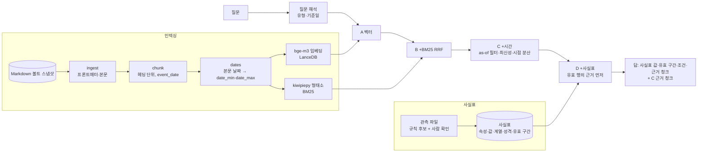

# temporal-vault-rag

[](https://github.com/0gnm0-afk/temporal-vault-rag/actions/workflows/tests.yml)

**날짜가 붙은 개인 기록에 "그때 값은?", "지금 값은?"을 물었을 때 RAG가 얼마나 맞게 찾는지, 투자에이전트의 지식 DB를 RAG로 옮기기 전에 작게 시험한 기록입니다.**

- **문제:** 의미로만 찾는 기본 RAG는 시점이 다른 값을 섞어 가져옵니다. 실제 기록 청크의 18%가 서로 다른 날짜의 값을 한 조각에 담고 있었습니다.
- **한 일:** 검색 모드를 네 단계로 쌓았습니다(A 벡터 → B +키워드 → C +날짜 처리 → D +유효 기간을 둔 사실표). 구현과 따로 만든 40문항 평가셋으로, 코드를 고정한 뒤 한 번씩 측정했습니다.
- **결과:** 과거 시점 값 Recall@5가 기본 RAG 0.58에서 사실표를 더한 D에서 0.88로 올랐습니다. 지금 값을 묻는 질문에서 최신 근거가 1위로 오는 비율은 0.20에서 0.80이 됐습니다. 사실표로 직접 답한 비율은 0.43에 그쳤습니다.
- **내가 정한 것:** 범위, 비교 설계, 평가셋 분리와 평가 전 코드 고정, 측정 조건 정의, 사실표 검수입니다. 구현은 AI 코딩 에이전트(Claude Code)가 했습니다([역할 분담](#역할-분담)).
- **근거:** [결과 표](#8-결과) · [구현 중 바꾼 결정](#10-구현-중-바꾼-결정) · [설계 판단](docs/design.md) · [노션 상세 기록](https://jelly-snapper-928.notion.site/42250951fc8481848e16e59026516996) · [재현](#13-재현-데모-볼트)

| 질문 유형 (비공개 평가셋 40문항) | 지표 | 기본 RAG (A) | 날짜 처리 (C) | 사실표 (D), 95% 구간 |
|---|---|---|---|---|
| 과거 시점 값 | Recall@5 | 0.58 | 0.46 | **0.88** [0.71, 1.00] |
| 지금 값 | 최신 근거가 1위인 비율 | 0.20 | 0.70 | **0.80** [0.50, 1.00] |
| 남은 한계 | 사실표로 답한 비율 | - | - | **0.43** [0.22, 0.65] |

과거 시점 값은 크게 좋아졌습니다. 하지만 사실표에 없는 질문과 변화 흐름은 풀지 못했습니다. 정리 노트(위키), 검색(RAG), 사실표(정형 DB)는 잘하는 일이 서로 달라서, 일을 나눠 맡기는 구조가 필요하다는 것이 결론입니다(12절).

- 실제 데이터: 개인 건강 기록 노트 약 100개(비공개). 코드와 평가 숫자만 공개합니다.
- 공개 재현용: 가상 인물의 운동·식단 기록 30개로 만든 합성 데모 볼트(`demo/vault/`)와 공개 평가셋 20문항(`demo/eval.jsonl`).
- 처리: 임베딩, 검색, 평가를 모두 로컬에서 했습니다. 기록 내용을 외부 API로 보내지 않았습니다.
- English summary는 맨 끝에 있습니다.

## 1. 왜 시작했나

- **투자 에이전트의 다음 버전을 준비하고 있습니다.** 별도 프로젝트로 투자 에이전트를 만들고 있습니다. 리포트, 뉴스, 재무 추정치, AI와 나눈 투자 대화를 쌓아 두고, 새 대화에서 그 맥락을 불러와 논의를 이어 가는 도구입니다.
- **지식 DB를 새로 설계하려 합니다.** 다음 버전은 이 지식 DB를 RAG 계열(의미 검색 + 키워드 검색 + 정형 DB + 에이전트가 도구로 꺼내 쓰는 구조)로 다시 설계할 계획입니다.
- **실제 자료를 옮기기 전에 작게 먼저 해 보고 싶었습니다.** 자료를 옮기고 나면 구조를 되돌리기 어렵습니다. 그래서 한 영역을 골라 RAG를 끝까지 한 바퀴 돌려 보기로 했습니다.
  - 고른 영역은 정답을 제가 확인할 수 있는 개인 건강 기록입니다.
  - 이 영역은 체중, 식단 한도, 운동 구성처럼 **같은 항목의 값이 시간에 따라 바뀝니다.** 그래서 "그때 값", "지금 값", "어떻게 바뀌었나"를 묻는 질문을 시험하기 좋습니다.
  - 투자 자료도 같은 성질을 가집니다. 이익 추정치, 목표주가, 투자 가설이 계속 바뀝니다.

## 2. 기존 방식: LLM 위키 + 에이전트의 키워드 검색

지금까지 기록은 Obsidian Markdown 위키에 쌓아 왔습니다. 대화가 끝나면 LLM 에이전트가 세션 기록을 쓰고 주제 노트와 현재 상태 노트를 고쳐 정리합니다. 질문하면 에이전트가 먼저 위키를 검색하고, 찾은 파일을 열어 읽은 뒤 답합니다. 검색은 grep 같은 키워드 검색과 링크 따라가기입니다. 흔히 "LLM 위키"라고 부르는 방식에 가깝습니다. 원문을 매번 다시 찾는 대신 에이전트가 정리해 둔 지식을 읽게 하는 방식입니다.

잘 되는 점:
- 정리 노트가 곧 "현재 상태"라서, 지금 값을 묻는 질문은 그 노트 하나만 읽으면 됩니다.
- 에이전트가 파일을 통째로 읽으니 앞뒤 맥락과 링크로 이어진 다른 노트까지 함께 봅니다.
- 숫자, 고유명사, 코드처럼 정확히 같은 단어는 키워드 검색이 확실히 찾습니다.
- 인덱스가 없어 따로 관리할 것이 없습니다. 근거도 파일 경로로 바로 확인됩니다.

한계:
- **정확한 단어를 알아야 찾습니다.** "몸무게"로 물으면 "체중"이라고 적힌 기록을 못 찾습니다. 기록에 쓴 단어를 제가 기억하고 있어야 합니다.
- **다 읽힐 수는 없습니다.** 위키 전체가 수백만 자라 모델의 문맥 창에 한 번에 들어가지 않습니다. 결국 에이전트가 고른 몇 파일만 읽고, 무엇을 고를지는 다시 키워드에 달려 있습니다.
- **정리할수록 과거가 지워집니다.** 현재 상태 노트를 새 값으로 고치는 순간 이전 값과 그 사이의 이력은 세션 기록과 Git 이력에만 흩어져 남습니다. "5월 중순에는 얼마였나"에 답하려면 에이전트가 그 흔적을 다시 모아 날짜를 추론해야 합니다.
- **다 읽어도 시점 판단은 남습니다.** 문맥에 전부 넣더라도 어느 기록이 언제 기준인지는 모델이 스스로 추론해야 합니다. 시간 지식 그래프 논문([Zep, arXiv 2501.13956](https://arxiv.org/abs/2501.13956))도 대화 전체를 문맥에 넣은 방식보다 시간 지식 그래프가 시간 추론 질문에서 더 나았다고 보고합니다.

## 3. 기존 방식과 RAG 비교

이번에 만든 RAG(아래 A-D)와 기존 방식을 나란히 놓았습니다. RAG 쪽은 이 레포의 평가 결과에 근거합니다. 기존 방식 쪽은 같은 평가셋으로 측정하지 않았으므로, 써 온 경험에 따른 정성적 비교입니다.

| 관점 | LLM 위키 + 키워드 검색 | 이번 RAG (A-D) |
|---|---|---|
| 찾는 방식 | 정확한 단어 일치, 에이전트가 파일을 골라 읽음 | 뜻이 비슷한 조각(벡터) + 단어 일치(BM25) + 날짜 구간 + 사실표 |
| 표현이 다를 때 | 못 찾음 | 벡터가 찾음. 다만 형태소가 어긋나면 하이브리드에서 오히려 묻히기도 함(9절 `demo-g5`) |
| 숫자·고유명사 | 강함 | 벡터만으로는 약해 BM25로 보완 |
| 많은 자료 | 문맥 창 한계로 골라 읽기에 의존 | 인덱스에서 바로 상위 k개. 노트 100개 임베딩은 CPU로 약 9분 |
| 지금 값 | 정리 노트를 읽으면 됨(가장 강한 쪽) | 최신 날짜 가중으로 좋아짐(최신성 0.30 → 0.70, 8절). 문서 날짜와 내용 날짜가 다르면 틀림 |
| 과거 시점 값 | 이력이 흩어져 에이전트가 추론해야 함 | 사실표의 유효 구간으로 크게 좋아짐(시점 고정 Recall@5 0.46 → 0.88). 단, 표에 넣은 속성만 |
| 변화 흐름 | 정리 노트에 요약이 있으면 강함 | 거의 개선 안 됨(이력 0.51 → 0.53). 시점이 많으면 상위 목록에 다 못 들어옴 |
| 맥락·연결 | 파일 통째·링크로 이어 읽음 | 조각 단위라 앞뒤가 끊김. 목록형 청크가 상위를 차지하기도 함 |
| 근거 확인 | 파일 경로 | 청크 id, 사실표 근거 청크, 답한 모드 |
| 관리 부담 | 노트 정리(에이전트가 함) | 인덱스 재빌드, 사실표 수작업 확인, 평가셋 관리 |
| 왜 틀렸는지 알기 | 검색어가 단순해 쉬움 | 점수 융합(RRF)·필터·감쇠가 겹쳐 설명이 필요함 |

정리하면 RAG는 기존 방식의 "정확한 단어를 알아야 한다"와 "과거 시점 값이 흩어진다"는 약점을 상당 부분 메웠습니다. 반면 지금 값과 흐름 요약은 잘 정리된 위키가 여전히 강합니다. RAG는 잘게 자른 조각을 다루기 때문에 맥락이 끊기고, 왜 그런 결과가 나왔는지 설명하기도 어렵습니다. 어느 한쪽이 다른 쪽을 대체한다기보다 맡길 일을 나누는 문제였습니다(12절).

## 4. 시점 질문에서 기본 RAG가 틀리는 이유

개인 기록은 같은 대상(체중, 식단 한도, 운동 구성)의 값이 계속 바뀝니다. 질문도 "5월 중순에는?", "지금은?", "어떻게 바뀌었어?"처럼 시점을 전제합니다. 의미가 비슷한 청크를 찾는 검색은 다음 이유로 틀립니다.

- **한 청크에 시점이 다른 값이 섞입니다.** 실제 기록에서 청크의 약 18%가 서로 다른 날짜를 둘 이상 담습니다. 요약·정리 노트는 "3월 a → 5월 b → 지금 c"를 한 단락에 씁니다. 청크 단위로 날짜를 걸러도 이런 청크는 걸러지지 않습니다.
- **측정 조건이 다른 기록이 섞입니다.** 아침 공복, 식후, 운동 직후에 잰 체중은 같은 날에도 1kg 넘게 다릅니다. 조건을 구분하지 않으면 "최근 값"이 조건이 다른 값이 됩니다.
- **문서 날짜가 내용 날짜와 다릅니다.** 정리 노트는 작성일이 붙어 있지만 내용은 몇 달에 걸칩니다. "현재 기준" 단락이 오래된 작성일을 달고 있으면 최신성 판단이 틀립니다.
- **값의 성격이 섞입니다.** 측정값, 사용자가 정한 목표·한도, 대화 중 나온 제안, 계산한 추정이 같은 모양(숫자+단위)으로 적혀 있습니다.

## 5. 구조



같은 흐름을 글로 적으면 이렇습니다. 노트 스냅샷을 헤딩 단위로 자르고, 청크마다 사건 날짜와 본문 날짜 구간을 붙입니다. 이것으로 벡터 인덱스와 형태소 BM25 인덱스를 만듭니다. 사실표는 규칙으로 뽑은 후보를 사람이 확인해 따로 만듭니다. 질문이 오면 유형과 기준일을 읽고, 모드 A부터 D까지 차례로 얹어 검색합니다. 모드는 누적됩니다. D는 C 위에, C는 B 위에 얹힙니다.

## 6. 모드

| 모드 | 무엇을 더하나 | 핵심 |
|---|---|---|
| A | 벡터 검색 | bge-m3 dense, LanceDB 코사인 전수 검색 |
| B | + BM25 | kiwipiepy 내용 형태소 BM25와 벡터 상위 50개를 RRF(k=60)로 합침 |
| C | + 시간 | 질문 해석(규칙)으로 유형·기준일을 읽고 유형별로 처리: 시점 고정은 `date_min > as_of` 청크를 미리 제외, 현재 값은 `0.5 ** (경과일 / 60일)`로 재정렬, 변화 추적은 서로 다른 날짜의 청크를 골라 시간순 정렬, 일반은 B |
| D | + 사실표 | 질문에서 속성을 찾으면 유형에 맞는 사실표 행(as_of에 유효한 행, 지금 열린 행, 전체 이력)을 고르고 그 근거 청크를 앞에 둔 뒤 C 결과로 채움. 속성을 못 찾으면 D = C |

**날짜 구간 (C).** 청크마다 원래 사건 날짜(`event_date`: 날짜 헤딩 → 프론트매터 `date` → `created`)와 별도로, 본문에 실제로 나오는 날짜(`yyyy-mm-dd`, `m/d`, `m월 d일`)로 내용 구간 `date_min`·`date_max`를 붙입니다. 링크 안 날짜와 숫자 나열·횟수(`76.4/31.8`, `12/15회`)는 뺍니다. 연도 없는 날짜는 청크 기준일에 가장 가까운 해로 정합니다.

**사실표 (D): Graphiti의 아이디어를 줄인 것.** Graphiti는 지식 그래프의 사실(엣지)마다 유효 시작·끝과 기록 시각을 두고, 새 사실이 옛 사실과 충돌하면 옛 것을 지우지 않고 무효화합니다. 여기서는 그 핵심만 남겼습니다.
- 그래프 대신 한 사람·소수 속성(체중, 인바디 3종, 식단 한도, 스쿼트 작업 중량, 운동 루틴)의 표 한 장으로 줄였습니다.
- 행마다 `유효시작·유효끝`(값이 참이었던 기간)과 `기록시각`(그 값을 처음 적은 날)을 따로 둡니다(이중 시간).
- 새 값이 들어오면 같은 체인의 직전 행 `유효끝`만 채웁니다. 행을 지우거나 덮어쓰지 않습니다.
- 추출은 LLM 대신 정규식 후보와 사람 확인으로 합니다.
- **측정 계열:** 체인은 (대상, 속성, 계열) 단위입니다. 아침 공복 측정과 식후·운동 직후 측정은 다른 계열이라, 식후 값이 들어와도 아침 공복 값의 유효 기간을 닫지 않습니다. 기본 답은 기본 계열만 쓰고, 다른 계열은 "참고"로 보입니다.
- **`성격` 칸:** 측정 / 사용자 결정 / 사용자 보고 / 제안 / 추정. 제안·추정 행은 별도 체인이라 측정·결정 값을 닫지 않고 답에는 참고로만 나옵니다. 기록 원본이 "사용자 사실", "당시 제안", "실제 채택"을 구분하는 규칙을 표에 옮긴 것입니다.

D 출력 예(데모, "2025년 4월 1일 기준 가장 최근 공복 체중은?"; 3/17 운동 직후 77.5kg은 다른 계열이라 답에 쓰이지 않습니다):

```
[D] 체중 · 집 체중계 · 아침 공복  (시점 2025-04-01)
    값 78.0kg  유효 2025-03-31 ~ 2025-04-14  성격: 측정  기록 2025-03-31  근거: sessions/2025-03-31 체중 반등.md::000, topics/체중 기록.md::007
    조건 근거: 체중 기록 > 측정 원칙
    직전 78.6kg  2025-03-03 ~ 2025-03-31
[C 근거 청크]
[D] #1 ... sessions/2025-03-31 체중 반등.md ...
```

## 7. 평가 방법

- **평가셋을 구현과 따로 만들었습니다.**
  - 파이프라인 코드를 보지 않은 별도 세션이 실제 기록만 읽고 60문항 초안을 썼습니다(유형 4개: 일반, 시점 고정, 현재 값, 변화 추적).
  - 제가 말투와 수치를 확인하고 애매한 문항을 빼서 40문항(10·12·10·8)으로 확정했습니다.
  - 문항마다 정답 문서·섹션, 시점 고정의 기준일, 변화 추적의 변화 시점과 값이 있습니다.
- **평가 전에 코드를 고정했습니다.**
  - 규칙과 파라미터(필터 방식, 반감기, 후보 수, 사실표 답 규칙)는 데모 평가셋과 직접 쓴 개발용 질문으로만 정했습니다.
  - 커밋으로 고정한 뒤(C: `6782118`, D: `c600570`) 비공개 평가셋을 한 번 돌렸습니다.
  - D는 평가 질문을 본 적 없는 새 세션에 구현을 맡겼습니다. 앞 단계 세션은 실패 분석 중에 평가 질문 일부를 읽었기 때문입니다.
- **사후 조정은 따로 기록했습니다.** 결과를 본 뒤 바꾼 것은 "사후"로 표시하고 바꾸기 전 숫자를 남겼습니다.
  - 보조 지표 `이력(m/d 포함)` 추가: 공식 이력 지표는 연도까지 적힌 날짜만 읽습니다.
  - 결과 메타데이터의 절대 경로 제거.
  - 사실표 표본 12건에 대한 제 확인 반영.
  - 세 가지 모두 공식 수치를 바꾸지 않았습니다.
- **지표:**
  - 문서·섹션 단위 Recall@5와 MRR(상위 20)
  - 시점 오염률: 시점 고정 질문의 상위 5개 중 기준일 뒤에 기록된 청크 비율
  - 최신성 정확도: 현재 값 질문의 1위가 정답 중 가장 늦은 기록인 비율
  - 이력 완결도: 변화 시점 날짜를 상위 10개가 덮는 비율
  - D 전용 값 정확도: D가 낸 숫자가 정답 숫자와 일치하는 비율. D가 답하지 못한 문항은 0으로 셉니다.
- **신뢰구간:** 질문 단위로 다시 뽑는 부트스트랩 2000회, 95% 구간입니다. 표의 칸은 `평균 [하한, 상한]`입니다.

## 8. 결과

### 실제 기록 (비공개, n=40: 일반 10, 시점 고정 12, 현재 값 10, 변화 추적 8)

질문 원문과 기록 내용은 싣지 않습니다. 구간이 넓으므로 차이는 구간과 함께 읽어야 합니다.

- **D (공식):** 고정 커밋 `c600570`로 한 번 돌린 결과입니다.
- **D (사후):** 사실표 표본 12건에 대한 제 확인을 반영해 다시 만든 사실표로 같은 코드를 돌린 결과입니다. 행 6개를 고쳤고, 바뀐 행은 측정 계열 4행·유효시작 1행·계열 1행입니다. 지표는 공식과 같았습니다(D 답이 달라진 문항 2개, 점수 변화 없음).

| 그룹 | 지표 | A | B | C | D (공식) | D (사후) |
|---|---|---|---|---|---|---|
| 전체 | Recall@5 문서 | 0.58 [0.44, 0.71] | 0.52 [0.38, 0.65] | 0.61 [0.48, 0.73] | 0.74 [0.63, 0.85] | 0.74 [0.63, 0.85] |
| 전체 | MRR 문서 | 0.60 [0.47, 0.73] | 0.54 [0.41, 0.65] | 0.66 [0.52, 0.78] | 0.84 [0.73, 0.94] | 0.84 [0.73, 0.94] |
| 일반 | Recall@5 섹션 | 0.95 [0.85, 1.00] | 0.50 [0.35, 0.65] | 0.50 [0.35, 0.65] | 0.50 [0.35, 0.65] | 0.50 [0.35, 0.65] |
| 시점 고정 | Recall@5 문서 | 0.58 [0.33, 0.83] | 0.29 [0.08, 0.54] | 0.46 [0.21, 0.71] | 0.88 [0.71, 1.00] | 0.88 [0.71, 1.00] |
| 시점 고정 | Recall@5 섹션 | 0.33 [0.08, 0.58] | 0.21 [0.00, 0.42] | 0.29 [0.08, 0.54] | 0.71 [0.50, 0.92] | 0.71 [0.50, 0.92] |
| 시점 고정 | 시점 오염률 | 0.52 [0.32, 0.73] | 0.65 [0.45, 0.83] | 0.50 [0.30, 0.70] | 0.40 [0.23, 0.57] | 0.40 [0.23, 0.57] |
| 현재 값 | Recall@5 문서 | 0.40 [0.15, 0.70] | 0.55 [0.25, 0.85] | 0.70 [0.50, 0.90] | 0.70 [0.50, 0.90] | 0.70 [0.50, 0.90] |
| 현재 값 | MRR 문서 | 0.39 [0.16, 0.66] | 0.44 [0.21, 0.71] | 0.82 [0.56, 1.00] | 0.90 [0.70, 1.00] | 0.90 [0.70, 1.00] |
| 현재 값 | 최신성 정확도 | 0.20 [0.00, 0.50] | 0.30 [0.00, 0.60] | 0.70 [0.40, 1.00] | 0.80 [0.50, 1.00] | 0.80 [0.50, 1.00] |
| 변화 추적 | Recall@5 문서 | 0.35 [0.18, 0.52] | 0.28 [0.21, 0.39] | 0.32 [0.24, 0.42] | 0.34 [0.24, 0.46] | 0.34 [0.24, 0.46] |
| 변화 추적 | 이력 완결도 | 0.48 [0.32, 0.65] | 0.44 [0.27, 0.61] | 0.51 [0.35, 0.68] | 0.53 [0.36, 0.69] | 0.53 [0.36, 0.69] |
| 변화 추적 | 이력(m/d 포함, 사후 지표) | 0.54 [0.35, 0.73] | 0.49 [0.29, 0.70] | 0.58 [0.38, 0.77] | 0.65 [0.45, 0.82] | 0.65 [0.45, 0.82] |
| 전체 | 값 정확도(D) | - | - | - | 0.41 [0.22, 0.60] | 0.41 [0.22, 0.60] |
| 전체 | D 응답률 | - | - | - | 0.43 [0.22, 0.65] | 0.43 [0.22, 0.65] |

A·B·C는 공식과 사후 실행이 같습니다(같은 인덱스와 코드).

- **질문 해석:** 질문 유형은 40/40이 맞았습니다. 시점 고정의 기준일은 ±7일 안에서 11/12가 맞았습니다. 어긋난 이유는 해석은 기간의 끝날("중순" → 20일)로 읽고, 라벨은 기록일로 적었기 때문입니다.
- **정답 라벨로 돌린 C·D:** 해석 대신 정답 라벨을 넣은 C·D는 위 C·D와 거의 같았습니다.

요약:
- **시점 고정이 가장 크게 좋아졌습니다.** D에서 문서 Recall@5가 0.46에서 0.88, 섹션 Recall@5가 0.29에서 0.71로 올랐습니다. 사실표의 유효 구간이 "시점이 섞인 청크" 문제를 직접 피합니다.
- **현재 값은 주로 C에서 좋아졌습니다.** 최신성이 0.30에서 0.70으로 올랐습니다.
- **변화 추적은 거의 그대로입니다.** 11절 한계를 참고하세요.
- **일반 질문의 섹션 Recall은 B부터 떨어집니다.** 정리 노트의 세션 목록 청크가 BM25에서 여러 질문에 두루 걸려 상위를 차지하기 때문입니다(A는 0.95).

### 데모 볼트 (공개, 20문항, 기준일 2025-06-30)

| 지표 (전체) | A | B | C | D |
|---|---|---|---|---|
| Recall@5 문서 | 0.73 | 0.71 | 0.78 | 0.87 |
| 시점 오염률 | 0.36 | 0.44 | 0.16 | 0.08 |
| 최신성 정확도 | 0.20 | 0.00 | 0.80 | 1.00 |

유형별 전체 표와 구간은 [demo/results/SUMMARY.md](demo/results/SUMMARY.md)에 있습니다. 데모의 D는 독립 검증이 아닙니다. D의 답 규칙 두 개(현재 값의 근거 순서, 묶음 단어 처리)를 데모 개발 실행을 보고 정했기 때문입니다. 독립 수치는 위의 실제 기록 쪽입니다. 질문 해석만 따로 보면 데모 20문항의 유형은 모두 맞았습니다.

## 9. 실패 사례 (데모 볼트)

- **측정 조건 함정 (`demo-p4`, "2025년 4월 1일 기준 가장 최근 공복 체중은?").** 3/17 헬스장 운동 직후 77.5kg이 3/31 공복 78.0kg보다 낮아서 "줄었다"로 읽히기 쉽습니다.
  - A·B: 1위에 4월 중순 이후 청크가 와서 기준일 뒤 기록이 상위 5개에 3-4개 섞였습니다(오염).
  - C: 날짜 필터로 오염은 1개로 줄었지만, 1위가 정답 섹션이 아니었습니다.
  - D: 아침 공복 계열에서 4/1에 유효한 3/31 행(78.0kg)과 그 근거 청크를 1위로 냈습니다. 운동 직후 값은 다른 계열이라 답에 쓰이지 않았습니다.
- **작성일 함정 (`demo-c1`, "지금 하루 칼로리 한도는?").** 정리 노트의 "현재 기준" 단락은 내용이 맞지만 노트 작성일(1월)이 날짜로 붙어 있습니다.
  - A·B: 이 청크를 1위로 내 최신성이 0이었습니다.
  - C·D: 최근 날짜로 재정렬해 6월 정리 청크가 1위가 됐습니다. D는 5/12부터 유효한 한도 2,000kcal를 함께 냈습니다.
- **어휘 불일치 (`demo-g5`, "장 볼 때 매번 사는 식품은?").** 질문의 "장 볼 때"와 노트의 "장보기"가 형태소로는 겹치지 않습니다. 대신 "때", "사"처럼 흔한 형태소가 다른 청크에 걸려, B·C·D에서 정답이 상위 5개 밖으로 밀렸습니다. A는 1위로 찾았습니다. RRF에서는 한쪽 목록에서만 강한 결과가 묻힙니다.

## 10. 구현 중 바꾼 결정

에이전트의 결과를 그대로 쓰지 않고 바꾸거나 되돌린 결정입니다. 누가 처음 그 형태를 만들었는지도 함께 적었습니다.

| 단계 | 처음 형태 | 바꾼 형태 | 이유 |
|---|---|---|---|
| 날짜 처리 | 정리 노트 청크에 노트 작성일이 날짜로 붙음 (에이전트의 청킹 규칙) | 본문에 나오는 날짜로 내용 구간을 따로 붙임 (제가 세 가지 안 중 선택) | 작성일 하나로는 몇 달에 걸친 내용의 시점을 대표하지 못함. 날짜를 믿지 않는 표시만 하는 안, 날짜별로 더 잘게 자르는 안은 버림 |
| 날짜 처리 | 연도 없는 날짜는 과거 쪽 해로 정함 (에이전트) | 기준일에 가장 가까운 해로 정함 | 11월 기록의 "4/30"이 실제로는 다음 해 목표일이었음 |
| 사실표 스키마 | 속성에 단백질 목표 포함 (시작안) | 스쿼트 작업 중량으로 교체 (에이전트 제안, 제가 승인) | 단백질은 권고가 반복될 뿐 값이 실제로 바뀐 기록이 거의 없음. 대가로 단백질 관련 3문항은 사실표로 답하지 못함 |
| 측정 조건 | 기록의 표현으로 추정한 범주(장비 3종, 측정 시점 6종) (에이전트) | 제가 실제 측정 방식으로 다시 정의: 장비 하나, 기본은 기상 직후 공복, 측정 시각이 달랐던 기간은 별도 계열, 날짜별 예외 | 기록에 없는, 측정한 사람만 아는 정보였음 |
| 기록 간 충돌 | 한 측정을 기록마다 다른 계열로 해석 | 계열을 "미확인"으로 두고 기본 답에서 뺌 | 어느 쪽도 확인할 수 없어 추정하지 않음 |
| 평가 후 진단 | D가 답하지 못한 14문항에 맞춰 속성 사전을 보강하는 안 | 원인만 분류하고 고치지 않음 (제 결정) | 결과를 보고 고치면 더 이상 독립 평가가 아님 |

## 11. 끝까지 남은 한계

- **D 응답률이 0.43입니다.** 일반 외 30문항 중 14문항에서 D가 사실표 속성을 찾지 못해 C와 같게 답했습니다.
  - (가) 사실표 속성 밖: 9문항. 예: 스키마에서 뺀 속성(단백질 목표), 스쿼트 외 운동의 수행 기록.
  - (나) 속성은 있지만 질문 어휘가 속성 사전에 없음: 5문항. 운동 루틴 행 안의 세부 항목을 묻는 경우입니다.
  - (다) 질문 해석 실패: 0문항. (라) 기타: 0문항.
  - 진단만 했고 사전과 스키마는 고치지 않았습니다. D가 답한 문항에서는 값이 대부분 맞았습니다.
- **변화 추적은 C·D에서 거의 좋아지지 않았습니다.**
  - 이력 완결도는 C 0.51, D 0.53입니다.
  - 변화 시점이 질문당 4-8개라 상위 10개 창이 좁습니다.
  - 청크 지표가 표·`m/d` 형식 날짜를 다 세지 못합니다. 사후 지표는 C 0.58, D 0.65입니다.
  - 운동 루틴을 한 행에 글로 담아 종목 단위의 변화를 따로 갖지 못합니다.
- **사실표는 규칙 후보와 사람 확인으로 만들었습니다.** 정규식 후보가 숫자 행 117개 중 62개(같은 날짜)만 찾았고, 나머지와 루틴 행은 수작업입니다. 확장하려면 추출을 다시 설계해야 합니다.
- **데이터가 작습니다.**
  - 한 사람의 기록 약 100개, 평가 40문항, 유형별 8-12문항이라 구간이 넓습니다.
  - 데모 평가셋은 20문항이고 D 규칙 일부를 데모로 정했습니다.
- **한국어 전용 규칙입니다.** 날짜 형식, 질문 해석 단서, 형태소 품사가 한국어 기준입니다.

### 쓸 때 유의할 점

해결하지 못한 문제를 알고 있으면 피해 갈 수 있습니다. 이 시스템을 쓸 때는 다음을 감안합니다.

- **답에 붙은 모드와 근거를 먼저 봅니다.**
  - D가 사실표로 답했으면 값의 유효 구간과 근거 청크가 함께 나옵니다.
  - D = C로 답했으면(속성 밖 질문) 근거 청크에 시점이 섞여 있을 수 있으니 날짜를 직접 확인합니다.
- **기간 표현보다 날짜로 묻습니다.** "9월 초"는 9/10로, "중순"은 20일로 해석됩니다. 정확한 기준일이 필요하면 날짜를 적습니다.
- **변화 흐름 질문은 빠진 기간이 있는지 봅니다.** 시간순 근거 목록에 비어 있는 달이 있으면 정리 노트나 위키를 함께 엽니다.
- **측정 조건이 다른 값은 따로 나옵니다.** 기본 계열(기상 직후 공복) 값이 답입니다. 식후·운동 직후 값은 "참고"로만 보입니다.
- **일반 질문은 벡터만 쓴 결과(A)도 같이 봅니다.** 정리 노트의 목록 청크가 BM25로 상위를 차지할 수 있습니다.

## 12. 배운 것

- **신기술이라고 다 해결해 주지 않습니다.**
  - RAG는 요즘 가장 많이 이야기되는 방식이고, 시작할 때는 "벡터 DB에 넣으면 알아서 찾아 주겠지"에 가까운 기대가 있었습니다.
  - 실제로는 모드를 넷이나 쌓아도 응답률 0.43, 변화 추적 0.53에서 멈췄습니다.
  - 각 단계가 앞 단계의 문제를 하나 풀면 새 문제가 하나 생겼습니다. 벡터는 표현 차이를 풀지만 정확한 숫자·단어에 약합니다. BM25는 단어 일치를 보탰지만 목록 청크를 끌어올렸습니다(일반 질문 섹션 Recall 0.95 → 0.50). 날짜 필터는 시점이 섞인 청크를 거르지 못했습니다. 사실표는 시점을 풀었지만 스키마 밖은 몰랐습니다.
- **기존 방식이 무조건 뒤떨어진 것은 아니었습니다.**
  - 지금 값과 흐름 요약은 잘 정리된 위키가 여전히 낫습니다.
  - 정확한 단어 검색은 키워드 검색이 더 확실합니다.
  - 사실표도 결국 "사람이 확인한 정리"라는 점에서 위키와 같은 일을 합니다.
- **결국 상호 보완입니다.** 맡길 일을 나누면 이렇게 됩니다.

| 맡길 일 | 맞는 방식 |
|---|---|
| 지금 상태, 결정, 흐름 요약 | 에이전트가 관리하는 정리 노트(위키) |
| 표현을 모르는 기억 찾기, 큰 원문 아카이브 | 의미 검색 + 키워드 검색(RAG) |
| 시점별로 바뀌는 숫자·결정 | 유효 기간을 둔 표(사실표, 정형 DB) |
| 어디서 찾을지 고르기 | 에이전트가 도구로 골라 쓰는 구조 |

- **한계를 아는 것이 구현보다 중요합니다.**
  - 이번 구현(코드, 테스트, 보고서 초안)은 AI 코딩 에이전트(Claude Code)가 했습니다. 단계마다 지시서를 쓰고 별도 세션에 맡긴 뒤 결과를 확인하는 방식이었습니다.
  - 구현은 맡길 수 있습니다. 하지만 기술이 무엇을 할 수 있고 무엇을 못 하는지는 제가 알아야 합니다. 그래야 시스템을 정확하게 쓸 수 있고, 틀린 답을 받았을 때 알아챌 수 있습니다.
- **투자 에이전트로 가져갈 것:**
  - 계속 바뀌는 숫자(이익 추정치 등)는 기준일을 붙여 덮어쓰지 않고 쌓습니다. 이 실습의 사실표와 같은 생각입니다.
  - 값의 성격을 구분합니다(사실 / 의견 / 내 가설). 이 실습의 `성격` 칸과 같은 생각입니다.
  - 답에 근거와 답한 경로를 함께 보입니다.
  - 평가셋은 도입 전에 따로 만듭니다.
- **회계·금융에서 익숙한 생각과 닮은 점:** 만들고 보니 몇 가지 설계가 회계·금융에서 이미 쓰는 생각과 닮아 있었습니다.
  - **시점 오염률 ↔ 미래 참조 편향.** "그 시점 값"을 물었는데 그 뒤에 기록된 자료가 섞이는 문제입니다. 백테스트에서 당시에는 몰랐던 정보를 쓰는 오류(look-ahead bias)와 같은 구조입니다.
  - **유효 기간과 기록 시각 ↔ 시점 기준 데이터.** 값이 참이었던 기간과 그 값을 알게 된 날을 따로 두었습니다. 나중에 알게 됐지만 그 전 시점의 상황을 보여 주는 정보를 어느 시점에 반영할지 따지는 일과 닮았습니다. 회계의 보고기간후사건 구분이 그런 예입니다.
  - **`성격` 칸 ↔ 근거의 출처 구분.** 장비로 잰 값, 제가 기억해서 말한 값, 대화 중 나온 제안, 계산한 추정을 구분했습니다. 감사에서 외부 증거와 경영진 진술, 추정치를 다르게 다루는 것과 같은 방향입니다.

### 역할 분담

결정은 제가 하고, 에이전트는 선택지를 내고 구현했습니다.

| 단계 | 제가 정한 것 | 에이전트가 한 것 |
|---|---|---|
| 범위 | 위키 전체(노트 약 780개) 대신, 값이 시간에 따라 바뀌고 정답을 제가 확인할 수 있는 건강 기록 약 100개로 좁힘 | 영역별 노트 수와 성질 조사 |
| 비교 설계 | 모드를 한 단계씩 쌓아 무엇이 어느 지표를 바꿨는지 보기로 함. 시점 오염률·최신성·이력 같은 시간 지표를 따로 두기로 함 | 모드와 지표 구현, 부트스트랩 구간 |
| 평가 독립성 | 평가셋은 구현을 보지 않은 세션이 쓰게 함. 60문항 초안의 말투와 수치를 확인해 애매한 것을 빼고 40문항 확정. 평가 전 코드 고정과 사후 조정 표시 규칙을 정함 | 초안 작성, 고정 커밋, 사후 기록 |
| 날짜 문제 | 세 가지 안 중 "본문 날짜로 구간 잡기"를 고름 | 문제 발견, 대안 제시, 구현 |
| 사실표 스키마 | 단백질 목표를 빼고 스쿼트 작업 중량을 넣음. `성격` 칸을 두어 제안·추정을 답에서 빼기로 함 | 데이터 조사와 스키마 제안 |
| 측정 조건 | 측정 장비, 기본 측정 시점, 측정 시각이 달랐던 기간과 날짜별 예외를 직접 정의함. 이것이 측정 계열 설계가 됨 | 기록 속 조건 표현 집계, 기록 간 충돌 표시 |
| 검수 | 에이전트가 확신하지 못한 사실표 12건을 확인함(예: 오후 시각이 찍힌 측정이 사실은 늦게 일어난 직후였음) | 확인 결과 반영, 재측정 |
| 결과 해석 | D가 답하지 못한 14문항은 원인만 진단하고 고치지 않기로 함 | 원인 분류 |
| 공개 범위 | 기록·인덱스·평가셋은 비공개, 코드·합성 데모·숫자만 공개 | 유출 방지 훅, 공개 전 점검 |

## 13. 재현 (데모 볼트)

Windows, Python 3.12, CPU 기준입니다.

```powershell
py -3.12 -m venv .venv
.venv\Scripts\Activate.ps1
pip install torch==2.15.0 --index-url https://download.pytorch.org/whl/cpu
pip install -r requirements.txt
pip install -e . --no-deps
Copy-Item .env.example .env
python scripts/download_model.py
python -m tvrag.run --config configs/demo.yaml --modes A B C CL D DL
```

- **실행 결과:** 위 명령으로 데모 볼트를 청킹하고, 인덱스를 만들고, 사실표를 만든 뒤 6개 모드를 평가합니다. CPU에서 2-3분 걸립니다. 결과는 `demo/results/<날짜>_<모드>.{json,md}`와 비교표 `<날짜>_ABCCLDDL.md`로 나옵니다. 같은 명령을 다시 돌리면 같은 결과 파일이 나옵니다.
- **모델:** bge-m3 dense 가중치 약 2.2GB를 받으며, 캐시 경로는 `.env`의 `HF_HOME`입니다.
- **테스트:** `python -m pytest -q`. 모델을 내려받지 않고 돌리려면 `-m "not slow"`를 붙입니다. GitHub Actions는 모델을 받지 않는 빠른 테스트만 돌립니다(`.github/workflows/tests.yml`).
- **한 질문 검색:** `python -m tvrag.retrieve --config configs/demo.yaml -m D -k 5 --ref 2025-06-30 "지금 하루 칼로리 한도는?"`
- **설계 판단:** `docs/design.md`
- **모듈별 역할:** `CLAUDE.md`

## 라이선스

열람 전용입니다(All rights reserved). 코드·문서·데모 데이터는 보는 것만 허용하고, 허락 없는 복제·수정·배포·재사용은 허용하지 않습니다. 자세한 문구는 [LICENSE](LICENSE)에 있습니다.

## English summary

A small, fully local pilot run before moving my investment-agent knowledge base to RAG. Until now my notes lived in an LLM-maintained Markdown wiki that an agent searched with keywords (grep) and read file by file; that needs the exact word and loses past values when notes are rewritten. I tested RAG on ~100 dated personal notes, adding time step by step (A vector → B +BM25 → C +date ranges and question-type rules → D +a small bitemporal fact table in the spirit of Graphiti) and measured it on a 40-question set written independently of the code, with the code frozen before each run. Point-in-time recall@5 rose from 0.58 (A) to 0.88 (D), but the fact table answered only 43% of time-dependent questions and change-history questions barely improved. Implementation was done by an AI coding agent (Claude Code); the scope, evaluation protocol, measurement definitions and fact-table review were my decisions. The main takeaway: know what each method can and cannot do, combine them, and use the system with those limits in mind.
