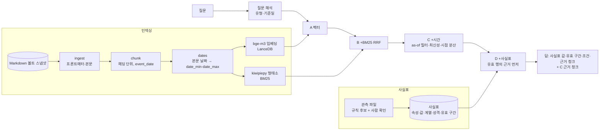

# temporal-vault-rag

> **English summary.** A small, fully local pilot run before moving my investment-agent knowledge base to RAG. Until now my notes lived in an LLM-maintained Markdown wiki that an agent searched with keywords (grep) and read file by file; that needs the exact word and loses past values when notes are rewritten. I tested RAG on ~100 dated personal notes, adding time step by step (A vector → B +BM25 → C +date ranges and question-type rules → D +a small bitemporal fact table in the spirit of Graphiti) and measured it on a 40-question set written independently of the code. RAG fixed some of the wiki's weaknesses, but not all of them, and it brought limits of its own. The main takeaway: know exactly what each method can and cannot do, combine them, and use the system with those limits in mind.

새 PC로 옮겨 가진 자료를 본격적으로 RAG로 바꾸기 전에, 작은 규모로 먼저 도입해 본 테스트다. 기존 방식(LLM이 관리하는 Markdown 위키를 에이전트가 키워드로 찾아 읽는 방식)의 한계를 보완하려고 RAG를 시험했다. 그런데 해 보니 RAG에도 분명한 한계가 있었다. 이 레포는 무엇이 나아졌고 무엇이 끝까지 안 됐는지를 숫자로 남긴 기록이다.

- 실제 데이터: 개인 건강 기록 노트 약 100개(비공개). 코드와 평가 숫자만 공개한다.
- 공개 재현용: 가상 인물의 운동·식단 기록 30개로 만든 합성 데모 볼트(`demo/vault/`)와 공개 평가셋 20문항(`demo/eval.jsonl`).
- 처리: 임베딩·검색·평가 모두 로컬. 기록 내용을 외부 API로 보내지 않았다.

## 1. 왜 시작했나

- **투자 에이전트의 다음 버전을 준비 중이다.** 별도 프로젝트로 투자 에이전트를 만들고 있다. 리포트·뉴스·재무 추정치·AI와 나눈 투자 대화를 쌓아 두고, 새 대화에서 그 맥락을 불러와 논의를 이어 가는 도구다.
- **지식 DB를 새로 설계하려 한다.** 다음 버전은 이 지식 DB를 RAG 계열(의미 검색 + 키워드 검색 + 정형 DB + 에이전트가 도구로 꺼내 쓰는 구조)로 다시 설계할 계획이다.
- **실제 자료를 옮기기 전에 작게 먼저 해 보고 싶었다.** 자료를 옮기고 나면 구조를 되돌리기 어렵다. 그래서 한 영역을 골라 RAG를 끝까지 한 바퀴 돌려 보기로 했다.
  - 고른 영역은 정답을 내가 확인할 수 있는 개인 건강 기록이다.
  - 이 영역은 체중·식단 한도·운동 구성처럼 **같은 항목의 값이 시간에 따라 바뀐다.** 그래서 "그때 값", "지금 값", "어떻게 바뀌었나"를 묻는 질문을 시험하기 좋다.
  - 투자 자료도 같은 성질을 가진다. 이익 추정치, 목표주가, 투자 가설이 계속 바뀐다.

## 2. 기존 방식: LLM 위키 + 에이전트의 키워드 검색

지금까지 기록은 Obsidian Markdown 위키에 쌓아 왔다. 대화가 끝나면 LLM 에이전트가 세션 기록을 쓰고 주제 노트와 현재 상태 노트를 고쳐 정리한다. 질문하면 에이전트가 먼저 위키를 검색하고, 찾은 파일을 열어 읽은 뒤 답한다. 검색은 grep 같은 키워드 검색과 링크 따라가기다. 흔히 "LLM 위키"라고 부르는 방식에 가깝다. 원문을 매번 다시 찾는 대신 에이전트가 정리해 둔 지식을 읽게 하는 방식이다.

잘 되는 점:
- 정리 노트가 곧 "현재 상태"라서, 지금 값을 묻는 질문은 그 노트 하나만 읽으면 된다.
- 에이전트가 파일을 통째로 읽으니 앞뒤 맥락과 링크로 이어진 다른 노트까지 함께 본다.
- 숫자·고유명사·코드처럼 정확히 같은 단어는 키워드 검색이 확실히 찾는다.
- 인덱스가 없어 따로 관리할 것이 없다. 근거도 파일 경로로 바로 확인된다.

한계:
- **정확한 단어를 알아야 찾는다.** "몸무게"로 물으면 "체중"이라고 적힌 기록을 못 찾는다. 내가 기록에 쓴 단어를 기억하고 있어야 한다.
- **다 읽힐 수는 없다.** 위키 전체가 수백만 자라 모델의 문맥 창에 한 번에 들어가지 않는다. 결국 에이전트가 고른 몇 파일만 읽고, 무엇을 고를지는 다시 키워드에 달려 있다.
- **정리할수록 과거가 지워진다.** 현재 상태 노트를 새 값으로 고치는 순간 이전 값과 그 사이의 이력은 세션 기록과 Git 이력에만 흩어져 남는다. "5월 중순에는 얼마였나"에 답하려면 에이전트가 그 흔적을 다시 모아 날짜를 추론해야 한다.
- **다 읽어도 시점 판단은 남는다.** 문맥에 전부 넣더라도 어느 기록이 언제 기준인지는 모델이 스스로 추론해야 한다. 시간 지식 그래프 논문([Zep, arXiv 2501.13956](https://arxiv.org/abs/2501.13956))도 대화 전체를 문맥에 넣은 방식보다 시간 지식 그래프가 시간 추론 질문에서 더 나았다고 보고한다.

## 3. 기존 방식과 RAG 비교

이번에 만든 RAG(아래 A-D)와 기존 방식을 나란히 놓았다. RAG 쪽은 이 레포의 평가 결과에 근거한다. 기존 방식 쪽은 이번에 같은 평가셋으로 측정하지 않았으므로 사용해 온 경험에 따른 정성적 비교다.

| 관점 | LLM 위키 + 키워드 검색 | 이번 RAG (A-D) |
|---|---|---|
| 찾는 방식 | 정확한 단어 일치, 에이전트가 파일을 골라 읽음 | 뜻이 비슷한 조각(벡터) + 단어 일치(BM25) + 날짜 구간 + 사실표 |
| 표현이 다를 때 | 못 찾음 | 벡터가 찾음. 다만 형태소가 어긋나면 하이브리드에서 오히려 묻히기도 함(9절 `demo-g5`) |
| 숫자·고유명사 | 강함 | 벡터만으로는 약해 BM25로 보완 |
| 많은 자료 | 문맥 창 한계로 골라 읽기에 의존 | 인덱스에서 바로 상위 k개. 노트 100개 임베딩은 CPU로 약 9분 |
| 지금 값 | 정리 노트를 읽으면 됨(가장 강한 쪽) | 최신 날짜 가중으로 좋아짐(최신성 0.30 → 0.70, 8절). 문서 날짜와 내용 날짜가 다르면 틀림 |
| 과거 시점 값 | 이력이 흩어져 에이전트가 추론해야 함 | 사실표의 유효 구간으로 크게 좋아짐(시점 고정 Recall@5 0.46 → 0.88). 단, 표에 넣은 속성만 |
| 변화 흐름 | 정리 노트에 요약이 있으면 강함 | 거의 개선 안 됨(이력 0.51 → 0.53). 시점이 많으면 상위 목록에 다 못 들어옴 |
| 맥락·연결 | 파일 통째·링크로 이어 읽음 | 조각 단위라 앞뒤가 끊김. 목록형 청크가 상위를 차지하기도 함 |
| 근거 확인 | 파일 경로 | 청크 id, 사실표 근거 청크, 답한 모드 |
| 관리 부담 | 노트 정리(에이전트가 함) | 인덱스 재빌드, 사실표 수작업 확인, 평가셋 관리 |
| 왜 틀렸는지 알기 | 검색어가 단순해 쉬움 | 점수 융합(RRF)·필터·감쇠가 겹쳐 설명이 필요함 |

정리하면 RAG는 기존 방식의 "정확한 단어를 알아야 한다"와 "과거 시점 값이 흩어진다"는 약점을 상당 부분 메웠다. 반면 지금 값과 흐름 요약은 잘 정리된 위키가 여전히 강하다. RAG는 잘게 자른 조각을 다루기 때문에 맥락이 끊기고, 왜 그런 결과가 나왔는지 설명하기도 어렵다. 어느 한쪽이 다른 쪽을 대체한다기보다 맡길 일을 나누는 문제였다(11절).

## 4. 시점 질문에서 기본 RAG가 틀리는 이유

개인 기록은 같은 대상(체중, 식단 한도, 운동 구성)의 값이 계속 바뀐다. 질문도 "5월 중순에는?", "지금은?", "어떻게 바뀌었어?"처럼 시점을 전제한다. 의미가 비슷한 청크를 찾는 검색은 다음 이유로 틀린다.

- **한 청크에 시점이 다른 값이 섞인다.** 실제 기록에서 청크의 약 18%가 서로 다른 날짜를 둘 이상 담는다. 요약·정리 노트는 "3월 a → 5월 b → 지금 c"를 한 단락에 쓴다. 청크 단위로 날짜를 걸러도 이런 청크는 걸러지지 않는다.
- **측정 조건이 다른 기록이 섞인다.** 아침 공복, 식후, 운동 직후에 잰 체중은 같은 날에도 1kg 넘게 다르다. 조건을 구분하지 않으면 "최근 값"이 조건이 다른 값이 된다.
- **문서 날짜가 내용 날짜와 다르다.** 정리 노트는 작성일이 붙어 있지만 내용은 몇 달에 걸친다. "현재 기준" 단락이 오래된 작성일을 달고 있으면 최신성 판단이 틀린다.
- **값의 성격이 섞인다.** 측정값, 사용자가 정한 목표·한도, 대화 중 나온 제안, 계산한 추정이 같은 모양(숫자+단위)으로 적혀 있다.

## 5. 구조



모드는 누적된다. D는 C 위에, C는 B 위에 얹힌다.

## 6. 모드

| 모드 | 무엇을 더하나 | 핵심 |
|---|---|---|
| A | 벡터 검색 | bge-m3 dense, LanceDB 코사인 전수 검색 |
| B | + BM25 | kiwipiepy 내용 형태소 BM25와 벡터 상위 50개를 RRF(k=60)로 합침 |
| C | + 시간 | 질문 해석(규칙)으로 유형·기준일을 읽고 유형별로 처리: 시점 고정은 `date_min > as_of` 청크를 미리 제외, 현재 값은 `0.5 ** (경과일 / 60일)`로 재정렬, 변화 추적은 서로 다른 날짜의 청크를 골라 시간순 정렬, 일반은 B |
| D | + 사실표 | 질문에서 속성을 찾으면 유형에 맞는 사실표 행(as_of에 유효한 행, 지금 열린 행, 전체 이력)을 고르고 그 근거 청크를 앞에 둔 뒤 C 결과로 채움. 속성을 못 찾으면 D = C |

**날짜 구간 (C).** 청크마다 원래 사건 날짜(`event_date`: 날짜 헤딩 → 프론트매터 `date` → `created`)와 별도로, 본문에 실제로 나오는 날짜(`yyyy-mm-dd`, `m/d`, `m월 d일`)로 내용 구간 `date_min`·`date_max`를 붙인다. 링크 안 날짜와 숫자 나열·횟수(`76.4/31.8`, `12/15회`)는 뺀다. 연도 없는 날짜는 청크 기준일에 가장 가까운 해로 정한다.

**사실표 (D): Graphiti의 아이디어를 줄인 것.** Graphiti는 지식 그래프의 사실(엣지)마다 유효 시작·끝과 기록 시각을 두고, 새 사실이 옛 사실과 충돌하면 옛 것을 지우지 않고 무효화한다. 여기서는 그 핵심만 남겼다.
- 그래프 대신 한 사람·소수 속성(체중, 인바디 3종, 식단 한도, 스쿼트 작업 중량, 운동 루틴)의 표 한 장으로 줄였다.
- 행마다 `유효시작·유효끝`(값이 참이었던 기간)과 `기록시각`(그 값을 처음 적은 날)을 따로 둔다(이중 시간).
- 새 값이 들어오면 같은 체인의 직전 행 `유효끝`만 채운다. 행을 지우거나 덮어쓰지 않는다.
- 추출은 LLM 대신 정규식 후보와 사람 확인으로 한다.
- **측정 계열**: 체인은 (대상, 속성, 계열) 단위다. 아침 공복 측정과 식후·운동 직후 측정은 다른 계열이라, 식후 값이 들어와도 아침 공복 값의 유효 기간을 닫지 않는다. 기본 답은 기본 계열만 쓰고, 다른 계열은 "참고"로 보인다.
- **`성격` 칸**: 측정 / 사용자 결정 / 사용자 보고 / 제안 / 추정. 제안·추정 행은 별도 체인이라 측정·결정 값을 닫지 않고 답에는 참고로만 나온다. 기록 원본이 "사용자 사실", "당시 제안", "실제 채택"을 구분하는 규칙을 표에 옮긴 것이다.

D 출력 예(데모, "2025년 4월 1일 기준 가장 최근 공복 체중은?"; 3/17 운동 직후 77.5kg은 다른 계열이라 답에 쓰이지 않는다):

```
[D] 체중 · 집 체중계 · 아침 공복  (시점 2025-04-01)
    값 78.0kg  유효 2025-03-31 ~ 2025-04-14  성격: 측정  기록 2025-03-31  근거: sessions/2025-03-31 체중 반등.md::000, topics/체중 기록.md::007
    조건 근거: 체중 기록 > 측정 원칙
    직전 78.6kg  2025-03-03 ~ 2025-03-31
[C 근거 청크]
[D] #1 ... sessions/2025-03-31 체중 반등.md ...
```

## 7. 평가 방법

- **평가셋을 구현과 따로 만들었다.**
  - 파이프라인 코드를 보지 않은 별도 세션이 실제 기록만 읽고 60문항 초안을 썼다(유형 4개: 일반, 시점 고정, 현재 값, 변화 추적).
  - 사람이 말투와 수치를 확인하고 애매한 문항을 빼서 40문항(10·12·10·8)으로 확정했다.
  - 문항마다 정답 문서·섹션, 시점 고정의 기준일, 변화 추적의 변화 시점과 값이 있다.
- **평가 전에 코드를 고정했다.**
  - 규칙과 파라미터(필터 방식, 반감기, 후보 수, 사실표 답 규칙)는 데모 평가셋과 직접 쓴 개발용 질문으로만 정했다.
  - 커밋으로 고정한 뒤(C: `6782118`, D: `c600570`) 비공개 평가셋을 한 번 돌렸다.
- **사후 조정은 따로 기록했다.** 결과를 본 뒤 바꾼 것은 "사후"로 표시하고 바꾸기 전 숫자를 남겼다.
  - 보조 지표 `이력(m/d 포함)` 추가: 공식 이력 지표는 연도까지 적힌 날짜만 읽는다.
  - 결과 메타데이터의 절대 경로 제거.
  - 사실표 표본 12건에 대한 사용자 확인 반영.
  - 세 가지 모두 공식 수치를 바꾸지 않았다.
- **지표**:
  - 문서·섹션 단위 Recall@5와 MRR(상위 20)
  - 시점 오염률: 시점 고정 질문의 상위 5개 중 기준일 뒤에 기록된 청크 비율
  - 최신성 정확도: 현재 값 질문의 1위가 정답 중 가장 늦은 기록인 비율
  - 이력 완결도: 변화 시점 날짜를 상위 10개가 덮는 비율
  - D 전용 값 정확도: D가 낸 숫자가 정답 숫자와 일치하는 비율. D가 답하지 못한 문항은 0으로 센다.
- **신뢰구간**: 질문 단위로 다시 뽑는 부트스트랩 2000회, 95% 구간. 표의 칸은 `평균 [하한, 상한]`이다.

## 8. 결과

### 데모 볼트 (공개, 20문항, 기준일 2025-06-30)

| 그룹 | 지표 | A | B | C | D |
|---|---|---|---|---|---|
| 전체 | Recall@5 문서 | 0.73 [0.59, 0.85] | 0.71 [0.57, 0.84] | 0.78 [0.64, 0.91] | 0.87 [0.74, 0.97] |
| 전체 | Recall@5 섹션 | 0.70 [0.55, 0.85] | 0.64 [0.48, 0.78] | 0.70 [0.55, 0.84] | 0.80 [0.67, 0.91] |
| 전체 | MRR 문서 | 0.97 [0.90, 1.00] | 0.83 [0.70, 0.93] | 0.90 [0.77, 1.00] | 0.93 [0.82, 1.00] |
| 전체 | 시점 오염률 | 0.36 [0.16, 0.60] | 0.44 [0.32, 0.56] | 0.16 [0.08, 0.20] | 0.08 [0.00, 0.16] |
| 전체 | 최신성 정확도 | 0.20 [0.00, 0.60] | 0.00 [0.00, 0.00] | 0.80 [0.40, 1.00] | 1.00 [1.00, 1.00] |
| 전체 | 이력 완결도 | 0.87 [0.60, 1.00] | 0.97 [0.90, 1.00] | 0.97 [0.90, 1.00] | 1.00 [1.00, 1.00] |
| 전체 | 이력(m/d 포함, 사후 지표) | 0.90 [0.70, 1.00] | 0.97 [0.90, 1.00] | 0.97 [0.90, 1.00] | 1.00 [1.00, 1.00] |
| 전체 | 값 정확도(D) | - | - | - | 1.00 [1.00, 1.00] |
| 전체 | D 응답률 | - | - | - | 1.00 [1.00, 1.00] |
| 일반 | Recall@5 문서 | 1.00 [1.00, 1.00] | 0.80 [0.40, 1.00] | 0.80 [0.40, 1.00] | 0.80 [0.40, 1.00] |
| 일반 | Recall@5 섹션 | 1.00 [1.00, 1.00] | 0.80 [0.40, 1.00] | 0.80 [0.40, 1.00] | 0.80 [0.40, 1.00] |
| 일반 | MRR 문서 | 1.00 [1.00, 1.00] | 0.82 [0.46, 1.00] | 0.82 [0.46, 1.00] | 0.82 [0.46, 1.00] |
| 시점 고정 | Recall@5 문서 | 0.80 [0.60, 1.00] | 0.80 [0.60, 1.00] | 0.80 [0.60, 1.00] | 1.00 [1.00, 1.00] |
| 시점 고정 | Recall@5 섹션 | 0.70 [0.30, 1.00] | 0.50 [0.20, 0.80] | 0.70 [0.30, 1.00] | 1.00 [1.00, 1.00] |
| 시점 고정 | MRR 문서 | 0.87 [0.60, 1.00] | 0.70 [0.50, 0.90] | 0.90 [0.70, 1.00] | 1.00 [1.00, 1.00] |
| 시점 고정 | 시점 오염률 | 0.36 [0.16, 0.60] | 0.44 [0.32, 0.56] | 0.16 [0.08, 0.20] | 0.08 [0.00, 0.16] |
| 현재 값 | Recall@5 문서 | 0.57 [0.37, 0.80] | 0.63 [0.47, 0.83] | 1.00 [1.00, 1.00] | 1.00 [1.00, 1.00] |
| 현재 값 | Recall@5 섹션 | 0.57 [0.33, 0.82] | 0.62 [0.43, 0.82] | 0.83 [0.72, 0.95] | 0.83 [0.72, 0.95] |
| 현재 값 | MRR 문서 | 1.00 [1.00, 1.00] | 0.80 [0.60, 1.00] | 1.00 [1.00, 1.00] | 1.00 [1.00, 1.00] |
| 현재 값 | 최신성 정확도 | 0.20 [0.00, 0.60] | 0.00 [0.00, 0.00] | 0.80 [0.40, 1.00] | 1.00 [1.00, 1.00] |
| 변화 추적 | Recall@5 문서 | 0.54 [0.30, 0.83] | 0.62 [0.37, 0.87] | 0.52 [0.32, 0.72] | 0.68 [0.49, 0.87] |
| 변화 추적 | Recall@5 섹션 | 0.55 [0.30, 0.84] | 0.63 [0.37, 0.88] | 0.46 [0.29, 0.65] | 0.56 [0.45, 0.66] |
| 변화 추적 | MRR 문서 | 1.00 [1.00, 1.00] | 1.00 [1.00, 1.00] | 0.87 [0.60, 1.00] | 0.90 [0.70, 1.00] |
| 변화 추적 | 이력 완결도 | 0.87 [0.60, 1.00] | 0.97 [0.90, 1.00] | 0.97 [0.90, 1.00] | 1.00 [1.00, 1.00] |

데모의 D는 독립 검증이 아니다. D의 답 규칙 두 개(현재 값의 근거 순서, 묶음 단어 처리)를 데모 개발 실행을 보고 정했다. 독립 수치는 아래 실제 기록 쪽이다. 질문 해석만 따로 보면 데모 20문항의 유형은 모두 맞았다.

### 실제 기록 (비공개, n=40: 일반 10, 시점 고정 12, 현재 값 10, 변화 추적 8)

질문 원문과 기록 내용은 싣지 않는다. 구간이 넓으므로 차이는 구간과 함께 읽어야 한다.

- **D (공식):** 고정 커밋 `c600570`로 한 번 돌린 결과.
- **D (사후):** 사실표 표본 12건에 대한 사용자 확인을 반영해 다시 만든 사실표로 같은 코드를 돌린 결과. 행 6개를 고쳤고, 바뀐 행은 측정 계열 4행·유효시작 1행·계열 1행이다. 지표는 공식과 같았다(D 답이 달라진 문항 2개, 점수 변화 없음).

| 그룹 | 지표 | A | B | C | D (공식) | D (사후) |
|---|---|---|---|---|---|---|
| 전체 | Recall@5 문서 | 0.58 [0.44, 0.71] | 0.52 [0.38, 0.65] | 0.61 [0.48, 0.73] | 0.74 [0.63, 0.85] | 0.74 [0.63, 0.85] |
| 전체 | MRR 문서 | 0.60 [0.47, 0.73] | 0.54 [0.41, 0.65] | 0.66 [0.52, 0.78] | 0.84 [0.73, 0.94] | 0.84 [0.73, 0.94] |
| 일반 | Recall@5 섹션 | 0.95 [0.85, 1.00] | 0.50 [0.35, 0.65] | 0.50 [0.35, 0.65] | 0.50 [0.35, 0.65] | 0.50 [0.35, 0.65] |
| 시점 고정 | Recall@5 문서 | 0.58 [0.33, 0.83] | 0.29 [0.08, 0.54] | 0.46 [0.21, 0.71] | 0.88 [0.71, 1.00] | 0.88 [0.71, 1.00] |
| 시점 고정 | Recall@5 섹션 | 0.33 [0.08, 0.58] | 0.21 [0.00, 0.42] | 0.29 [0.08, 0.54] | 0.71 [0.50, 0.92] | 0.71 [0.50, 0.92] |
| 시점 고정 | 시점 오염률 | 0.52 [0.32, 0.73] | 0.65 [0.45, 0.83] | 0.50 [0.30, 0.70] | 0.40 [0.23, 0.57] | 0.40 [0.23, 0.57] |
| 현재 값 | Recall@5 문서 | 0.40 [0.15, 0.70] | 0.55 [0.25, 0.85] | 0.70 [0.50, 0.90] | 0.70 [0.50, 0.90] | 0.70 [0.50, 0.90] |
| 현재 값 | MRR 문서 | 0.39 [0.16, 0.66] | 0.44 [0.21, 0.71] | 0.82 [0.56, 1.00] | 0.90 [0.70, 1.00] | 0.90 [0.70, 1.00] |
| 현재 값 | 최신성 정확도 | 0.20 [0.00, 0.50] | 0.30 [0.00, 0.60] | 0.70 [0.40, 1.00] | 0.80 [0.50, 1.00] | 0.80 [0.50, 1.00] |
| 변화 추적 | Recall@5 문서 | 0.35 [0.18, 0.52] | 0.28 [0.21, 0.39] | 0.32 [0.24, 0.42] | 0.34 [0.24, 0.46] | 0.34 [0.24, 0.46] |
| 변화 추적 | 이력 완결도 | 0.48 [0.32, 0.65] | 0.44 [0.27, 0.61] | 0.51 [0.35, 0.68] | 0.53 [0.36, 0.69] | 0.53 [0.36, 0.69] |
| 변화 추적 | 이력(m/d 포함, 사후 지표) | 0.54 [0.35, 0.73] | 0.49 [0.29, 0.70] | 0.58 [0.38, 0.77] | 0.65 [0.45, 0.82] | 0.65 [0.45, 0.82] |
| 전체 | 값 정확도(D) | - | - | - | 0.41 [0.22, 0.60] | 0.41 [0.22, 0.60] |
| 전체 | D 응답률 | - | - | - | 0.43 [0.22, 0.65] | 0.43 [0.22, 0.65] |

A·B·C는 공식과 사후 실행이 같다(같은 인덱스와 코드).

- **질문 해석:** 질문 유형 40/40이 맞았다. 시점 고정의 기준일은 ±7일 안에서 11/12가 맞았는데, 해석은 기간의 끝날("중순" → 20일)로 읽고 라벨은 기록일로 적은 차이다.
- **정답 라벨로 돌린 C·D:** 해석 대신 정답 라벨을 넣은 C·D는 위 C·D와 거의 같았다.

요약:
- **시점 고정이 가장 크게 좋아졌다.** D에서 문서 Recall@5가 0.46에서 0.88, 섹션 Recall@5가 0.29에서 0.71로 올랐다. 사실표의 유효 구간이 "시점이 섞인 청크" 문제를 직접 피한다.
- **현재 값은 주로 C에서 좋아졌다.** 최신성이 0.30에서 0.70으로 올랐다.
- **변화 추적은 거의 그대로다.** 10절 한계 참고.
- **일반 질문의 섹션 Recall은 B부터 떨어진다.** 정리 노트의 세션 목록 청크가 BM25에서 여러 질문에 두루 걸려 상위를 차지하기 때문이다(A는 0.95).

## 9. 실패 사례 (데모 볼트)

- **측정 조건 함정 (`demo-p4`, "2025년 4월 1일 기준 가장 최근 공복 체중은?").** 3/17 헬스장 운동 직후 77.5kg이 3/31 공복 78.0kg보다 낮아서 "줄었다"로 읽히기 쉽다.
  - A·B: 1위에 4월 중순 이후 청크가 와서 기준일 뒤 기록이 상위 5개에 3-4개 섞였다(오염).
  - C: 날짜 필터로 오염은 1개로 줄었지만, 1위가 정답 섹션이 아니었다.
  - D: 아침 공복 계열에서 4/1에 유효한 3/31 행(78.0kg)과 그 근거 청크를 1위로 냈다. 운동 직후 값은 다른 계열이라 답에 쓰이지 않았다.
- **작성일 함정 (`demo-c1`, "지금 하루 칼로리 한도는?").** 정리 노트의 "현재 기준" 단락은 내용이 맞지만 노트 작성일(1월)이 날짜로 붙어 있다.
  - A·B: 이 청크를 1위로 내 최신성이 0이었다.
  - C·D: 최근 날짜로 재정렬해 6월 정리 청크가 1위가 됐다. D는 5/12부터 유효한 한도 2,000kcal를 함께 냈다.
- **어휘 불일치 (`demo-g5`, "장 볼 때 매번 사는 식품은?").** 질문의 "장 볼 때"와 노트의 "장보기"가 형태소로는 겹치지 않는다. 대신 "때"·"사"처럼 흔한 형태소가 다른 청크에 걸려, B·C·D에서 정답이 상위 5개 밖으로 밀렸다. A는 1위로 찾았다. RRF에서는 한쪽 목록에서만 강한 결과가 묻힌다.

## 10. 끝까지 남은 한계

- **D 응답률이 0.43이다.** 일반 외 30문항 중 14문항에서 D가 사실표 속성을 찾지 못해 C와 같게 답했다.
  - (가) 사실표 속성 밖: 9문항. 예: 스키마에서 뺀 속성(단백질 목표), 스쿼트 외 운동의 수행 기록.
  - (나) 속성은 있지만 질문 어휘가 속성 사전에 없음: 5문항. 운동 루틴 행 안의 세부 항목을 묻는 경우.
  - (다) 질문 해석 실패: 0문항. (라) 기타: 0문항.
  - 진단만 했고 사전·스키마는 고치지 않았다. D가 답한 문항에서는 값이 대부분 맞았다.
- **변화 추적은 C·D에서 거의 좋아지지 않았다.**
  - 이력 완결도는 C 0.51, D 0.53이다.
  - 변화 시점이 질문당 4-8개라 상위 10개 창이 좁다.
  - 청크 지표가 표·`m/d` 형식 날짜를 다 세지 못한다. 사후 지표는 C 0.58, D 0.65다.
  - 운동 루틴을 한 행에 글로 담아 종목 단위의 변화를 따로 갖지 못한다.
- **사실표는 규칙 후보와 사람 확인으로 만들었다.** 정규식 후보가 숫자 행 117개 중 62개(같은 날짜)만 찾았고, 나머지와 루틴 행은 수작업이다. 확장하려면 추출을 다시 설계해야 한다.
- **데이터가 작다.**
  - 한 사람의 기록 약 100개, 평가 40문항, 유형별 8-12문항이라 구간이 넓다.
  - 데모 평가셋은 20문항이고 D 규칙 일부를 데모로 정했다.
- **한국어 전용 규칙이다.** 날짜 형식, 질문 해석 단서, 형태소 품사가 한국어 기준이다.

### 쓸 때 유의할 점

해결하지 못한 문제를 알고 있으면 피해 갈 수 있다. 이 시스템을 쓸 때는 다음을 감안한다.

- **답에 붙은 모드와 근거를 먼저 본다.**
  - D가 사실표로 답했으면 값의 유효 구간과 근거 청크가 함께 나온다.
  - D = C로 답했으면(속성 밖 질문) 근거 청크에 시점이 섞여 있을 수 있으니 날짜를 직접 확인한다.
- **기간 표현보다 날짜로 묻는다.** "9월 초"는 9/10로, "중순"은 20일로 해석된다. 정확한 기준일이 필요하면 날짜를 적는다.
- **변화 흐름 질문은 빠진 기간이 있는지 본다.** 시간순 근거 목록에 비어 있는 달이 있으면 정리 노트나 위키를 함께 연다.
- **측정 조건이 다른 값은 따로 나온다.** 기본 계열(기상 직후 공복) 값이 답이다. 식후·운동 직후 값은 "참고"로만 보인다.
- **일반 질문은 벡터만 쓴 결과(A)도 같이 본다.** 정리 노트의 목록 청크가 BM25로 상위를 차지할 수 있다.

## 11. 배운 것

- **신기술이라고 다 해결해 주지 않는다.**
  - RAG는 요즘 가장 많이 이야기되는 방식이고, 시작할 때는 "벡터 DB에 넣으면 알아서 찾아 주겠지"에 가까운 기대가 있었다.
  - 실제로는 모드를 넷이나 쌓아도 응답률 0.43, 변화 추적 0.53에서 멈췄다.
  - 각 단계가 앞 단계의 문제를 하나 풀면 새 문제가 하나 생겼다. 벡터는 표현 차이를 풀지만 정확한 숫자·단어에 약하다. BM25는 단어 일치를 보탰지만 목록 청크를 끌어올렸다(일반 질문 섹션 Recall 0.95 → 0.50). 날짜 필터는 시점이 섞인 청크를 거르지 못했다. 사실표는 시점을 풀었지만 스키마 밖은 몰랐다.
- **기존 방식이 무조건 뒤떨어진 것은 아니었다.**
  - 지금 값과 흐름 요약은 잘 정리된 위키가 여전히 낫다.
  - 정확한 단어 검색은 키워드 검색이 더 확실하다.
  - 사실표도 결국 "사람이 확인한 정리"라는 점에서 위키와 같은 일을 한다.
- **결국 상호 보완이다.** 맡길 일을 나누면 이렇게 된다.

| 맡길 일 | 맞는 방식 |
|---|---|
| 지금 상태, 결정, 흐름 요약 | 에이전트가 관리하는 정리 노트(위키) |
| 표현을 모르는 기억 찾기, 큰 원문 아카이브 | 의미 검색 + 키워드 검색(RAG) |
| 시점별로 바뀌는 숫자·결정 | 유효 기간을 둔 표(사실표, 정형 DB) |
| 어디서 찾을지 고르기 | 에이전트가 도구로 골라 쓰는 구조 |

- **한계를 아는 것이 구현보다 중요하다.**
  - 이번 구현은 거의 다 AI 에이전트에게 맡겼다. 내가 직접 한 일은 이 셋이다.
    - 무엇을 비교할지 정하고
    - 평가셋을 구현과 떼어 놓고
    - 결과를 읽고 한계를 받아들이는 것
  - 구현은 맡길 수 있다. 하지만 기술이 무엇을 할 수 있고 무엇을 못 하는지는 내가 알아야 한다. 그래야 시스템을 정확하게 쓸 수 있고, 틀린 답을 받았을 때 알아챌 수 있다.
- **투자 에이전트로 가져갈 것:**
  - 계속 바뀌는 숫자(이익 추정치 등)는 기준일을 붙여 덮어쓰지 않고 쌓는다. 이 실습의 사실표와 같은 생각이다.
  - 값의 성격을 구분한다(사실 / 의견 / 내 가설). 이 실습의 `성격` 칸과 같은 생각이다.
  - 답에 근거와 답한 경로를 함께 보인다.
  - 평가셋은 도입 전에 따로 만든다.

## 12. 재현 (데모 볼트)

Windows, Python 3.12, CPU 기준.

```powershell
py -3.12 -m venv .venv
.venv\Scripts\Activate.ps1
pip install torch==2.15.0 --index-url https://download.pytorch.org/whl/cpu
pip install -r requirements.txt
pip install -e . --no-deps
Copy-Item .env.example .env
python scripts/download_model.py
python -m tvrag.run --config configs/demo.yaml --modes A B C CL D DL
```

- **실행 결과:** 위 명령으로 데모 볼트를 청킹하고, 인덱스를 만들고, 사실표를 만든 뒤 6개 모드를 평가한다. CPU에서 2-3분 걸린다. 결과는 `demo/results/<날짜>_<모드>.{json,md}`와 비교표 `<날짜>_ABCCLDDL.md`로 나온다. 같은 명령을 다시 돌리면 같은 결과 파일이 나온다.
- **모델:** bge-m3 dense 가중치 약 2.2GB를 받으며, 캐시 경로는 `.env`의 `HF_HOME`이다.
- **테스트:** `python -m pytest -q`. 모델을 내려받지 않고 돌리려면 `-m "not slow"`를 붙인다.
- **한 질문 검색:** `python -m tvrag.retrieve --config configs/demo.yaml -m D -k 5 --ref 2025-06-30 "지금 하루 칼로리 한도는?"`
- **설계 판단:** `docs/design.md`
- **모듈별 역할:** `CLAUDE.md`

## 라이선스

열람 전용이다(All rights reserved). 코드·문서·데모 데이터는 보는 것만 허용하고, 허락 없는 복제·수정·배포·재사용은 허용하지 않는다. 자세한 문구는 [LICENSE](LICENSE).
